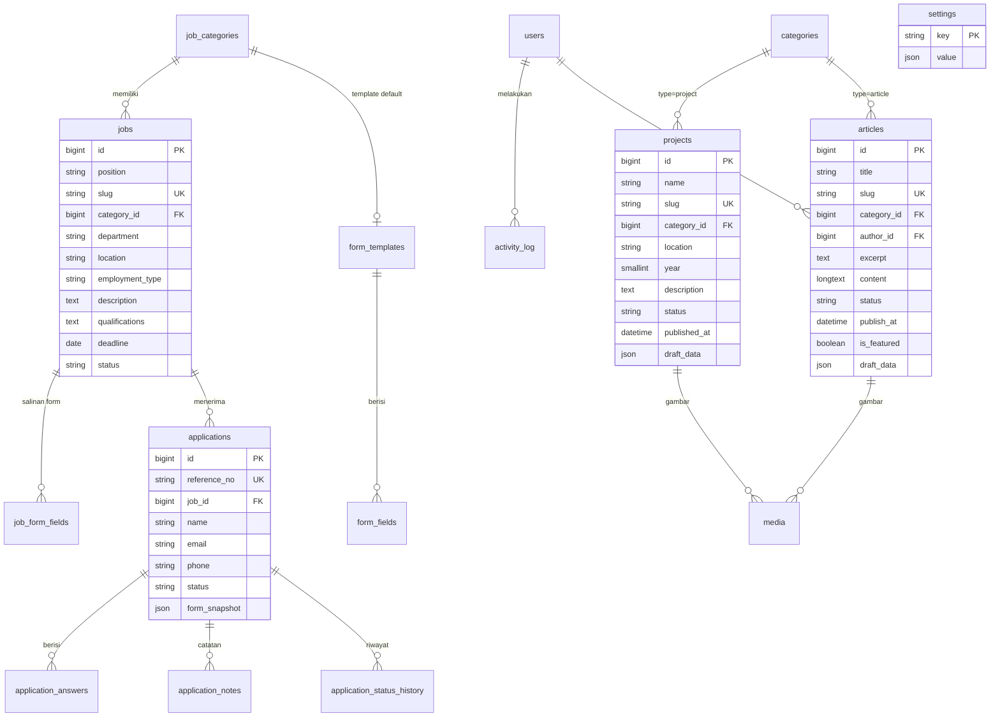

# PROJECT STRUCTURE
## Website Company Profile & Portfolio

| | |
|---|---|
| **Versi** | 0.2 (Draft) |
| **Acuan** | SRS v1.1, STYLE GUIDE v0.1 |
| **Stack** | Laravel 13.42 (PHP 8.3) · Filament 5.11 (admin) · Blade + JavaScript biasa (publik; Livewire hanya di admin) · Tailwind CSS 4 · MySQL 8.4 · Spatie packages |
| **Status** | Tahap 0 sampai 8 selesai (seluruh modul F1 berjalan; 241 tes otomatis lulus). Tahap 9 (styling final, SEO, performa, aksesibilitas) dan seluruh F2 belum. Warna dan font belum dikunci klien. |

---

## 1. Dua Area Aplikasi

Satu aplikasi Laravel, dua area dengan tujuan berbeda:

| Area | URL | Teknologi | Isi |
|---|---|---|---|
| **Publik** | `/` | Blade + JavaScript biasa + Tailwind (tanpa Livewire dan Alpine) | Projects, About, News, Careers, Contact, Search |
| **Admin** | `/admin` | Filament | Seluruh dashboard (SRS Bagian 4–10) |

Keduanya memakai **model dan database yang sama**. Logika bisnis (publish, status, gambar) ditaruh di lapisan Service/Action, bukan di controller atau halaman Filament, agar dipakai bersama.

---

## 2. Struktur Folder

```
progressive-architecture/            ← root proyek Laravel
├── app/
│   ├── Models/                      ← Project, Article, Category, Job, ...
│   ├── Enums/                       ← ContentStatus, ApplicationStatus, FieldType
│   ├── Actions/                     ← satu kelas = satu aksi bisnis
│   │   ├── Content/                 ← PublishContent, SchedulePublish, SaveDraft
│   │   ├── Media/                   ← ProcessImage, CommitMedia, PurgeOrphans
│   │   └── Recruitment/             ← SubmitApplication, ChangeApplicantStatus
│   ├── Services/                    ← logika lintas-modul (Search, Settings)
│   ├── Jobs/                        ← proses antrean (gambar, email, GC)
│   ├── Console/Commands/            ← perintah terjadwal (publish terjadwal, deadline)
│   ├── Http/
│   │   ├── Controllers/Site/        ← controller tipis untuk halaman publik
│   │   └── Requests/                ← validasi form (Contact, Application)
│   ├── Livewire/                    ← komponen interaktif publik
│   │   ├── ProjectGrid.php          ← infinite scroll + filter kategori
│   │   ├── SearchOverlay.php        ← live search
│   │   └── ApplicationForm.php      ← form lamaran dinamis
│   ├── Filament/
│   │   ├── Resources/               ← Projects, Articles, Categories, Jobs, Applicants, Users
│   │   ├── Pages/                   ← Settings, AboutUs, Dashboard
│   │   └── Widgets/                 ← 4 metrik, Recent Activities, Recent Applications
│   └── Policies/                    ← akses (saat ini semua admin setara)
│
├── database/
│   ├── migrations/
│   ├── factories/
│   └── seeders/
│
├── resources/
│   ├── views/
│   │   ├── layouts/                 ← app.blade.php (publik)
│   │   ├── components/              ← project-card, category-bar, lightbox, ...
│   │   ├── pages/                   ← projects/, about/, news/, careers/, contact/
│   │   └── livewire/
│   ├── css/app.css                  ← token Tailwind (dari STYLE GUIDE)
│   └── js/app.js                    ← Alpine, PhotoSwipe
│
├── routes/
│   ├── web.php                      ← rute publik
│   └── console.php                  ← jadwal (scheduler)
│
├── storage/app/
│   ├── private/                     ← dokumen lamaran (tidak publik)
│   └── public/media/                ← gambar + varian (diakses via symlink)
│
├── tests/
│   ├── Feature/                     ← alur utama (publish, lamaran, kontak)
│   └── Unit/                        ← Actions dan Services
│
└── Documents/                       ← SRS, Style Guide, dokumen ini
```

> Pohon folder di atas adalah rencana awal. Yang kini ada di luar rencana: `app/Actions/Articles`, `app/Actions/Recruitment`, `app/Actions/About`, `app/Services/AdminNotifier.php` dan `SiteSearch.php`, `app/Support/ApplicationForm.php`, `PublicArticle.php`, `PublicProject.php`, `app/Models/Concerns/HasDraftMedia.php`, widget dashboard di `app/Filament/Widgets`, dan seeder demo di `database/seeders` (lihat Bagian 10, Data demo).

---

## 3. Pemetaan SRS ke Kode

Kolom model dan Filament menunjukkan **kenyataan di kode**, bukan rencana awal.

| Modul SRS | Model utama | Filament | Publik |
|---|---|---|---|
| Projects (5.1) | `Project` (termasuk data teknis: klien, tipologi, luas tanah/bangunan, lantai, status) | `ProjectResource` (editor auto-save) | `/`, `/projects/{slug}` |
| Articles (5.2) | `Article` | `ArticleResource` (editor auto-save, rich text, Schedule, Featured) | `/news`, `/news/{slug}` |
| Categories (5.3) | `Category` (satu tabel, kolom `type`) | `CategoryResource` (2 tab) | — |
| About Us (5.4) | `AboutPage` (satu dokumen JSON; anggota tim punya `id`) | `ManageAboutUs` (page, foto per anggota tim) | `/about` |
| Job Vacancies (6.1) | `JobVacancy` (tabel `job_vacancies`; `jobs` dipakai antrean Laravel) | `JobVacancyResource` | `/careers`, `/careers/{slug}` |
| Form Builder (6.2) | `FormField` (pustaka isian) + `JobCategory` (centang bawaan per kategori) | `FormFieldResource` (menu "Form Builder"), `JobCategoryResource` (menu "Job Categories") | form lamaran di detail lowongan |
| Applicants (6.3) | `JobApplication`, `JobApplicationFile`, `JobApplicationNote`, `JobApplicationStatusChange` | `JobApplicationResource` (tabel + halaman detail) | — |
| Users (7) | `User` | `UserResource` | — |
| Settings (8) | `Setting` | `ManageSettings` (page) | navbar, footer, SEO |
| Activity Logs (9) | `Activity` (Spatie) | `ActivityLogResource` | — |
| Notifications (10) | `notifications` (bawaan Laravel) | lonceng di topbar; dikirim oleh `AdminNotifier` | — |
| Images (12) | `MediaFile`, `MediaUsage` (pipeline sendiri, bukan medialibrary) | `ProjectMediaManager` (Livewire) | `<x-responsive-image>` |
| Search (3.4, 4.4) | — (LIKE, `SiteSearch`) | pencarian global bawaan Filament | `/search`, overlay live |
| Dashboard (4.3) | — | `DashboardStats`, `RecentActivities`, `RecentApplications` | — |
| Contact (3.8) | — (tanpa tabel) | — | `/contact` → Mail |

---|---|---|---|
| Projects (5.1) | `Project` | `ProjectResource` | `/`, `/projects/{slug}` |
| Articles (5.2) | `Article` | `ArticleResource` | `/news`, `/news/{slug}` |
| Categories (5.3) | `Category` (satu tabel, kolom `type`) | `CategoryResource` (2 tab) | — |
| About Us (5.4) | `AboutSection`, `Statistic`, `TeamMember` | `ManageAboutUs` (page) | `/about` |
| Job Vacancies (6.1) | `Job`, `JobCategory` | `JobResource` | `/careers`, `/careers/{slug}` |
| Form Builder (6.2) | `FormTemplate`, `FormField` | `FormTemplateResource` | form lamaran |
| Applicants (6.3) | `Application`, `ApplicationAnswer`, `ApplicationNote` | `ApplicationResource` | — |
| Users (7) | `User` | `UserResource` | — |
| Settings (8) | `Setting` | `ManageSettings` (page) | navbar, footer, SEO |
| Activity Logs (9) | `Activity` (Spatie) | `ActivityResource` | — |
| Notifications (10) | `notifications` (bawaan Laravel) | bell di topbar | — |
| Images (12) | `Media` (Spatie) | komponen upload | `<x-responsive-image>` |
| Contact (3.8) | — (tanpa tabel) | — | `/contact` → Mail |

---

## 4. Paket yang Dipakai

| Kebutuhan | Paket |
|---|---|
| Dashboard admin | `filament/filament` (sudah membawa Livewire dan Alpine untuk area admin) |
| Gambar dan varian | `intervention/image` (driver GD) + pipeline sendiri (`UploadMedia`, `ProcessMediaImage`, `MediaFile`, `MediaUsage`). **`spatie/laravel-medialibrary` tidak dipakai.** |
| Activity Logs | `spatie/laravel-activitylog` |
| Pencarian | `LIKE` biasa lewat `SiteSearch` (tanpa Elasticsearch dan tanpa full-text; lihat Tahap 8) |
| Lightbox | PhotoSwipe |
| Font | Inter (self-hosted lewat `@fontsource-variable/inter`) |
| Test | **PHPUnit** (bukan Pest) |
| Pemformat kode | Laravel Pint |
| Bantuan pengembangan | `laravel/boost` (dev): panduan di `CLAUDE.md` dan `AGENTS.md`, server MCP di `.mcp.json` |

**Direncanakan tetapi belum dipasang:** `spatie/laravel-sluggable` (slug dibuat di model dan Action), `spatie/eloquent-sortable` (urutan memakai kolom `sort_order` dan `reorderable()` Filament), `spatie/laravel-responsecache` (cache halaman publik belum ada).

Penambahan paket baru dicatat di sini agar daftar ini tetap menjadi sumber kebenaran.

---

## 5. Rancangan Database (F1)



### Realisasi di kode (penyimpangan dari diagram di atas)
Diagram di atas adalah rancangan awal dan sengaja tidak diubah. Yang akhirnya dibangun:

| Rancangan | Kenyataan |
|---|---|
| `jobs`, `applications` | `job_vacancies`, `job_applications` (nama `jobs` bentrok dengan tabel antrean Laravel) |
| `form_templates`, `form_fields`, `job_form_fields` | **Pustaka isian** di tabel `form_fields` (isian standar dibuat oleh migrasi); kategori menyimpan centang bawaan (`job_categories.default_field_keys`, `default_required_keys`); lowongan menyimpan salinan formulir sebagai JSON `job_vacancies.form_fields` |
| `application_answers` | Jawaban dan salinan struktur formulir sebagai JSON di `job_applications` (`answers`, `form_snapshot`); dokumen di `job_application_files` |
| `application_status_history` | `job_application_status_changes` |
| `articles.publish_at` | `articles.scheduled_at` (jadwal) dan `published_at` (terbit pertama) |
| Anggota tim di tabel sendiri | Bagian dari dokumen JSON `about_pages`; foto lewat `media_usages` dengan peran `team:{id}` |
| Notifikasi | Tabel `notifications` bawaan Laravel; penanda pengingat `deadline_h3_notified_at` dan `deadline_h0_notified_at` di `job_vacancies` |

### Catatan desain
- **Draft dan published dipisah** lewat kolom `draft_data` (JSON). Kolom utama berisi versi published, jadi frontend tidak perlu logika tambahan, dan perubahan draft tidak menimpa konten publik (SRS 11.2).
- **`form_snapshot`** pada `applications` menyalin struktur form saat pelamar mengirim, sesuai FR-RC-023.
- **Contact tidak punya tabel**, sesuai FR-FE-091.
- **Pola draft/publish dipakai bersama** oleh Project, Article, dan About Us: kolom utama (atau `published`) = versi terbit, `draft_data` (atau `draft`) = editan, `media_usages.is_draft` memisahkan gambar draft dan published. Logika gambar berversi ada di trait `HasDraftMedia`.
- **Version History, Edit Lock, deduplikasi, dan notifikasi real-time (F2)** belum masuk skema. Struktur di atas tidak menghalanginya, misalnya tabel `content_versions` dan `edit_locks` dapat ditambahkan kemudian.

---

## 6. Rute Publik

| URL | Fungsi |
|---|---|
| `/` | Daftar proyek (infinite scroll, filter kategori) |
| `/projects/{slug}` | Detail proyek |
| `/about` | About Us |
| `/news` | Listing artikel |
| `/news/{slug}` | Detail artikel |
| `/careers` | Daftar lowongan |
| `/careers/{slug}` | Detail lowongan + form lamaran |
| `/contact` | Form kontak |
| `/team` | Dialihkan (301) ke `/about#team`; Team sekarang bagian di dalam halaman About |
| `/about?member=id#team` | Membuka profil anggota tertentu di bagian Team (tombol Preview di editor About Us ikut menampilkan Team) |
| `/search?q=` | Hasil pencarian lengkap (filter `type`, noindex) |
| `/search/live?q=` | Fragmen HTML untuk overlay live search |
| `/preview/projects/{id}`, `/preview/about`, `/preview/news/{id}` | Preview draft untuk admin aktif (noindex, tanpa cache) |
| `/admin/application-files/{id}` | Dokumen lamaran (pratinjau/unduh); hanya admin aktif, selain itu 404 |

> Pola URL kategori belum diputuskan (SRS Bagian 15, butir 1). Saat ini kategori dipakai sebagai filter tanpa URL sendiri.

---

## 7. Proses Latar Belakang

| Proses | Pemicu | Keterangan |
|---|---|---|
| Image processing | Setelah upload (`ProcessMediaImage`) | Antrean `database`; **worker harus hidup** (`php artisan queue:work` atau `composer dev`), kalau tidak gambar tetap Waiting |
| Publish terjadwal | Scheduler **tiap menit** (`articles:publish-scheduled`) | Menerbitkan artikel Scheduled yang waktunya tiba; waktu terbit = waktu jadwal; gagal validasi = kembali ke Draft |
| Pengingat deadline | Scheduler **harian 07.00** (`jobs:notify-deadlines`) | Notifikasi H-3 dan hari-H untuk lowongan Published, sekali per tahap |
| Garbage collection media | Scheduler harian 03.00 (`media:purge`) | Retensi 7 hari (FR-IM-072) |
| Kirim email kontak | Antrean | Agar form tidak menunggu SMTP; 5 kali percobaan ulang |
| Notifikasi dashboard | **Sinkron** (bukan antrean) | Notifikasi bawaan Filament masuk antrean; dikirim langsung agar lonceng andal tanpa worker |

Scheduler dijalankan satu entri cron: `* * * * * cd /path/to/app && php artisan schedule:run`.

---|---|---|
| Image processing | Setelah upload | Antrean khusus, 1 worker, memori dibatasi (NFR-CAP-001) |
| Publish terjadwal | Scheduler tiap menit | Mengubah status Scheduled menjadi Published |
| Pengingat deadline | Scheduler harian | Membuat notifikasi Job Deadline |
| Bersihkan file temporary | Scheduler harian | FR-IM-011 |
| Garbage collection media | Scheduler harian | Retensi 7 hari (FR-IM-072) |
| Kirim email kontak | Antrean | Agar form tidak menunggu SMTP |

---

## 8. Urutan Pembangunan (F1)

| Tahap | Isi | Hasil yang bisa dilihat |
|---|---|---|
| 0 | Setup Laravel, Filament, Tailwind, database, login admin | Dashboard kosong bisa dibuka |
| 1 | Settings + Users + Activity Logs | Admin bisa kelola akun dan pengaturan |
| 2 | Categories | Kategori proyek dan artikel |
| 3 | Pipeline gambar (upload, varian, antrean) | **Titik risiko terbesar. Uji beban di sini.** |
| 4 | Projects (admin) + listing dan detail publik | Halaman utama portfolio tampil |
| 5 | Draft/publish + auto-save | Alur konten sesuai SRS 11 |
| 6 | Articles + About Us | Konten lengkap |
| 7 | Careers + form lamaran + Applicants | Rekrutmen berjalan |
| 8 | Contact, Search, Notifikasi | Fitur pendukung |
| 9 | Styling final, SEO, uji performa dan aksesibilitas | Siap rilis |

**Status:** tahap 0 sampai 8 selesai (detail per tahap di Bagian 10). Tahap 9 belum dikerjakan. Pada kenyataannya tahap 5 menyatu dengan tahap 4, dan Careers (tahap 7) serta Search dan Notifikasi (tahap 8) dikerjakan setelah News dan foto tim About.

Tahap 3 sengaja didahulukan sebelum konten lain, karena kemampuan server 2 GB menentukan seberapa besar sisa rencana dapat direalisasikan.

---

## 9. Konvensi Penamaan

- **Tabel:** jamak, snake_case (`project_categories`). **Model:** tunggal, PascalCase (`ProjectCategory`).
- **Status** disimpan sebagai string dari Enum PHP, bukan angka.
- **Aksi bisnis** = satu kelas di `app/Actions/` dengan satu method `handle()`.
- **Controller tipis**: validasi dan panggil Action, tidak berisi logika bisnis.
- **Komponen Blade**: kebab-case, nama menjelaskan fungsi.
- **Test** untuk setiap Action yang mengubah status atau data penting.

---

## 10. Keputusan

| # | Keputusan | Hasil |
|---|---|---|
| 1 | Database | **MySQL 8.4** (Laragon). Harus sama di lokal dan produksi. |
| 2 | Lokasi kode | **Di folder ini** (`d:\DEV\Progressive architecture\`), berdampingan dengan `Documents/`. |
| 3 | Repositori Git | **Ditunda.** Dibuat belakangan. |
| 4 | Versi Laravel dan Filament | **Versi stabil terbaru yang saling kompatibel**, dikunci di `composer.lock`. Lihat catatan pemasangan di bawah. |
| 5 | Urutan frontend | **Dibangun per halaman**, berdampingan dengan modul admin terkait (lihat Bagian 8). |

### Status Tahap 0 (selesai)
- Laravel 13.42 dan Filament 5.11 terpasang; panel admin di `/admin`.
- Database lokal `progressive_architecture` (MySQL 8.4, user `root` tanpa password, **hanya untuk lokal**).
- Zona waktu aplikasi: `Asia/Jakarta`.
- Akun admin lokal: `admin@progressive.test` / `password`. **Ganti atau hapus sebelum dipakai di luar lokal.**
- Tailwind 4 dan Vite bawaan skeleton; build berhasil.
- MySQL perlu dijalankan manual (Laragon) sebelum membuka aplikasi.

### Status Tahap 1 (selesai)
- **Users** (`/admin/users`): Create, Edit, Reset Password, Deactivate/Reactivate; tanpa hapus akun. Administrator aktif terakhir tidak bisa dinonaktifkan. Hanya akun aktif yang bisa masuk panel. Last Login tercatat.
- **Website Settings** (`/admin/settings`): lima tab sesuai SRS Bagian 8. Disimpan di tabel `settings` (key/JSON) lewat `App\Services\Settings`; perubahan tercatat dengan nilai sebelum dan sesudah.
- **Activity Logs** (`/admin/activity-logs`): baca-saja, filter modul dan aksi, detail Before/After. Perubahan password dicatat tanpa nilainya.
- **Profil** (`/admin/profile`): nama, email, password (bawaan Filament).
- Tes otomatis: `tests/Feature/AdminFoundationTest.php` (8 tes lulus).
- Catatan: upload logo/favicon/avatar sementara memakai disk `public` biasa. Akan dipindah ke pipeline gambar pada tahap 3.
- Catatan: di PowerShell 5.1, `Set-Content -Encoding utf8` menambahkan BOM dan merusak file PHP/.env. Gunakan alat Edit/Write.

### Status Tahap 2 (selesai)
- **Categories** (`/admin/categories`): satu menu, dua tab (Project Categories, Article Categories). Create, Edit, Delete, Reorder (drag), Search. Slug dibuat otomatis dan unik per jenis; urutan dihitung per jenis.
- **Keputusan desain:** satu tabel `categories` dengan kolom `type` (bukan dua tabel). Konten (`projects`, `articles`) nanti memakai kolom `category_id` yang menunjuk ke tabel ini; kategori harus berjenis sesuai (divalidasi di form konten).
- **Aturan hapus (FR-CM-004, FR-CM-042):** kategori yang dipakai tidak bisa dihapus. Dijaga di model (`deleting`) dan tombol dinonaktifkan dengan alasan. Pengecekan membaca tabel konten, jadi otomatis berlaku begitu tabel `projects`/`articles` dibuat (tahap 4 dan 6). Pada tahap itu tambahkan juga foreign key `restrictOnDelete()`.
- Tes: `tests/Feature/CategoryTest.php` (8 tes). Seluruh suite: 16 tes lulus.

### Status Tahap 3 (inti selesai, antarmuka upload menyusul di tahap 4)

**Sudah ada (backend, teruji):**
- Upload: validasi berdasarkan **isi file** (bukan nama), maks 50 MB, JPG/PNG/WebP, batas piksel dibaca dari header sebelum didekode (anti "bom dekompresi").
- Deduplikasi SHA-256: gambar identik disimpan sekali; unggah ulang memakai baris yang sama.
- Antrean pemrosesan (`ProcessMediaImage`) menghasilkan varian WebP 400/800/1280/1920/2560/3840, **tanpa upscaling**, aspect ratio terjaga, EXIF dibuang setelah orientasi diterapkan. Kegagalan satu gambar hanya menandai gambar itu `failed` dan bisa diulang.
- Alt text, caption, dan focal point disimpan **per penggunaan** (`media_usages`), bukan per file.
- Siklus hidup: unggahan baru → antrean sementara; dipasang ke konten (`AttachMedia`) → resmi; dilepas (`DetachMedia`) → antrean hapus 7 hari; dipakai lagi dalam masa itu → antrean dibatalkan. `media:purge` berjalan harian pukul 03:00, mengecek ulang referensi tepat sebelum menghapus, dan mencatat di Activity Logs.
- Parameter ada di `config/media.php`. Tes: `tests/Feature/MediaPipelineTest.php` (20 tes). Seluruh suite: 36 tes lulus.

**Hasil ukur (GD, foto noise = kasus terburuk, mesin lokal):**

| Foto | Memori puncak | Waktu |
|---|---|---|
| 24 MP (6000×4000, 20 MB) | ±196 MB | 18–32 dtk |
| 48 MP (8000×6000, 41 MB) | ±314 MB | ±25 dtk |

Kesimpulan: **muat di server 2 GB** bila gambar diproses satu per satu. Batch 20 foto besar bisa makan beberapa menit di latar belakang, jadi antarmukanya harus menampilkan status per gambar. Job menaikkan `memory_limit` sendiri ke 768M, dan menolak gambar dengan pesan jelas bila memori tidak cukup. Dibuktikan lewat worker nyata ber-limit 128 MB.

**Belum dikerjakan (sengaja):**
- Antarmuka upload (antrean per gambar, progress, retry, hapus dari antrean, 3–4 file paralel) dan **Select from Existing Media**: dibangun bersama form Projects di tahap 4, karena baru di sana ada tempat memakainya.
- Varian cover 16:9 dan 4:5 dengan focal point (FR-IM-030..032): bergantung pada penggunaan cover, juga tahap 4.
- Rekomendasi alt text otomatis (FR-IM-041, prioritas C/F2).
- Konversi profil warna ke sRGB: **tidak bisa dengan GD** (butuh Imagick/libvips). Foto dengan profil Adobe RGB atau Display P3 bisa tampak sedikit pudar.
- Konten yang dihapus harus melepas penggunaannya lewat model (bukan cascade database). Pengaman `media:purge` menangkap yang terlewat.
- Saat Version History (F2) dibuat, versi lama harus menyimpan referensi gambarnya agar tidak ikut terhapus.

**Keputusan yang perlu dikonfirmasi:**
1. File asli unggahan **disimpan privat** (`storage/app/private/media`) agar varian bisa dibuat ulang bila kualitas diubah. SRS tidak menyebutnya. Biayanya: sekitar 1× ukuran unggahan di storage.
2. Batas piksel awal 50 MP dan 12.000 px per sisi (SRS Bagian 15 butir 3).
3. Retensi unggahan yang tidak pernah dipakai: 24 jam (SRS Bagian 15 butir 4).
4. Sharpening ringan (level 5) hanya pada varian yang diperkecil; belum dievaluasi dengan foto proyek asli.

### Status Tahap 4a: Admin Projects (selesai; halaman publik = 4b)

**Sudah ada** (`/admin/projects`, teruji: 73 tes lulus seluruh suite):
- Daftar proyek (cover, nama draft, kategori, tahun, status, filter status dan kategori, pencarian), Create (nama + kategori, lalu langsung ke editor), Edit, Archive/Restore, Delete.
- **Draft/publish (SRS 11.2):** kolom utama `projects` = versi published; editan masuk `draft_data` dan baris `media_usages` bertanda `is_draft`. Publish menyalin draft ke versi published. Status (`Draft`, `Published`, `Unpublished Changes`, `Archived`) dihitung dari keadaan nyata, jadi editan yang dikembalikan seperti semula otomatis kembali ke Published. "Discard changes" mengembalikan draft ke versi published.
- **Auto-save (SRS 11.1):** ±1,5 dtk setelah berhenti mengetik, dengan indikator Saving / Saved / Not saved dan tombol Retry. Tombol Save bawaan Filament dimatikan (method `save()` bawaan juga dialihkan, karena terbuka dari browser dan akan melewati aturan draft).
- **Pengaman tabrakan edit (FR-WF-004):** setiap simpan membawa nomor versi draft; versi usang ditolak. Publish menaikkan versi sehingga tab lama tidak bisa menimpa. Ini pengaman sementara sebelum Edit Lock (F2).
- **Pengelola gambar** untuk Cover dan Gallery: unggah banyak file (maks 20), status per gambar (Waiting / Processing / Completed / Failed) dengan polling otomatis, Retry, Remove, urutan naik/turun, alt text dan caption per gambar. Cover punya **titik fokus** (klik gambar) dan pratinjau potongan 16:9 dan 4:5.
- Gambar yang hanya dipakai draft **terlindungi dari pembersihan** (dihitung sebagai penggunaan).
- Kategori yang dipakai proyek kini tidak bisa dihapus, dijaga di model **dan** foreign key database.
- Aktivitas dicatat: created, published (nilai sebelum/sesudah), draft_discarded, archived, restored, deleted. Auto-save tidak dicatat agar log tidak banjir.

**Keputusan desain yang perlu dikonfirmasi:**
1. **Cover tidak membuat varian terpotong di server.** Rasio 16:9 dan 4:5 dicapai di frontend dengan CSS (`aspect-ratio` + `object-position` dari titik fokus). Lebih hemat storage dan memori, dan hasil cropnya identik secara visual. Menyimpang dari kata "varian khusus" di FR-IM-030.
2. **Satu titik fokus** untuk desktop dan mobile. Titik terpisah per perangkat ada di F2 (FR-IM-032).
3. `published_at` = waktu publikasi **pertama**, agar urutan listing stabil. Waktu setiap publikasi akan tercatat di Version History (F2).
4. Archived: dipulihkan ke Draft (bila belum pernah dipublikasikan) atau Published / Unpublished Changes. Ini asumsi sementara (SRS Bagian 15 butir 5).

**Belum dikerjakan (sengaja):**
- **Preview** proyek: butuh halaman publik, jadi di 4b.
- **Select from Existing Media** (F2), progres unggahan per gambar dan batas 3–4 unggahan paralel: unggahan memakai satu batch Livewire dengan indikator "Uploading…" lalu status per gambar. Drag-and-drop urutan masih tombol ↑↓.
- Notifikasi "Project Published" (tahap 8) dan status Scheduled untuk proyek (SRS Bagian 15 butir 9).
- ~~Belum pernah dicoba di browser sungguhan.~~ **Sudah diverifikasi** di Chrome pada tahap 4c (lihat di bawah): buat proyek, auto-save, unggah cover dan galeri (diproses worker nyata), titik fokus, alt text, urutan, publish, Unpublished Changes, dan discard semuanya berfungsi.

**Penting saat menjalankan lokal:** gambar diproses oleh antrean, jadi worker harus hidup (`php artisan queue:work`, atau `composer dev`). Tanpa worker, gambar tetap berstatus **Waiting**.

### Status Tahap 4b: Website publik Projects (selesai)

**Sudah ada** (diverifikasi di Chrome sungguhan: 42 pemeriksaan lulus, ditambah 95 tes otomatis):
- **Homepage = daftar proyek** (`/`), grid editorial asimetris berpola tetap (8 item per pola, berkesinambungan antar batch), tanpa hero. Judul proyek minimal.
- **Bar kategori** dinamis: hanya kategori yang punya proyek published, urutan dari admin, tanpa "All", sticky di bawah navbar, bisa digeser. Pindah kategori **tanpa reload**; klik kategori aktif membatalkan pilihan.
- **Infinite scroll** 8 proyek per muat, lazy loading, skeleton, tanpa permintaan ganda, berhenti saat habis. **Posisi scroll dipulihkan** saat kembali dari detail. **Fallback pagination** tanpa JavaScript.
- **Detail proyek** (`/projects/{slug}`): nama, kategori, lokasi, tahun, deskripsi, cover (16:9 desktop, 4:5 mobile, mengikuti titik fokus), galeri berpola asimetris, **lightbox** (PhotoSwipe: layar penuh, latar gelap, panah/Escape/swipe, klik di luar menutup, indikator 01/06, resolusi tinggi saat dibuka), Next/Previous project.
- **Preview draft** untuk admin (`/preview/projects/{id}`, tombol Preview di editor): hanya untuk admin aktif, noindex, tidak di-cache, dengan penanda "Preview".
- **Navbar sticky + menu layar penuh + footer** dari Website Settings. Halaman About/News/Careers/Contact sementara berupa penanda "sedang disiapkan" (noindex) agar menu tidak berujung 404.
- **Gambar responsif** (`<x-responsive-image>`): srcset dari varian WebP, `sizes` sesuai lebar kolom, dimensi eksplisit, titik fokus.
- Font **Inter dihosting sendiri**; token warna dan tipografi di `resources/css/app.css` mengikuti STYLE GUIDE.
- Publish kini **ditahan bila ada gambar yang belum siap** (masih diproses/gagal), agar tidak tampil kosong di website.
- `php artisan db:seed --class=DemoProjectsSeeder` mengisi 20 proyek demo dengan gambar sintetis untuk melihat tampilan (berhenti bila sudah ada proyek, jadi aman). Seeder itu **belum dijalankan** di database Anda; data demo yang saya pakai untuk verifikasi sudah dihapus.

**Hasil ukur (Chrome, 1440×900 dan 390×844):**
- CLS: **0,0001** saat memuat dan saat menggulir daftar; di mobile 0,0000. (Mulanya 0,38–0,70, lihat catatan di bawah.)
- JavaScript aplikasi ±6 KB gzip, CSS ±15 KB gzip; PhotoSwipe (±17 KB gzip) hanya dimuat di halaman detail saat galeri dibuka.
- Tidak ada galat konsol atau permintaan gagal.

**Masalah yang ditemukan dan diperbaiki lewat pengujian browser:**
1. **Layout shift footer** pada infinite scroll. Penyebab: pengguna yang menggulir lebih cepat dari pemuatan sampai ke footer, lalu batch baru mendorongnya keluar layar. Perbaikan berlapis: kerangka (skeleton) satu batch penuh yang meniru pola dan tinggi item asli, jumlahnya mengikuti sisa proyek yang sebenarnya, dan `overflow-anchor: none` pada `<main>` agar browser menjadikan footer sebagai jangkar. Catatan: pengecualian harus di level `main`, bukan hanya di dalam grid.
2. **Pagination fallback tetap terlihat saat JavaScript aktif.** Utility Tailwind `flex` (layer utilities) mengalahkan aturan `display:none` saya (layer components). Aturannya dipindah ke luar layer.
3. Lightbox: opsi `imageClickAction: 'close'` yang saya tambahkan sendiri dihapus; klik pada foto kembali ke perilaku bawaan (zoom), klik area gelap di luar foto yang menutup.

**Keputusan desain yang perlu dikonfirmasi:**
1. **Tanpa kategori terpilih, homepage menampilkan semua proyek** (SRS: "tanpa kategori All Projects" tetapi homepage langsung berisi proyek). Tidak ada tombol "All"; mengeklik kategori aktif membatalkan pilihan.
2. Urutan listing: **terbaru dipublikasikan dulu**. SRS tidak menyebut aturan urutan proyek; bila klien ingin urutan manual, perlu field urutan.
3. Kategori dipilih lewat `?category=slug`, bukan path URL (SRS Bagian 15 butir 1 masih terbuka). Mengubahnya nanti mudah.
4. Warna dan font masih **usulan dari STYLE GUIDE**, belum keputusan klien.

**Belum dikerjakan:**
- ~~Pencarian global di navbar, halaman About, News, Careers, Contact.~~ Kini selesai (lihat Tahap 4c, 6a, 7, dan 8).
- Meta SEO per proyek di luar judul/deskripsi/og:image dasar, sitemap, dan data terstruktur.
- Cache halaman publik (`spatie/laravel-responsecache`) belum dipasang; halaman dirender per permintaan.
- Uji di Safari dan Firefox belum dilakukan (hanya Chrome). Perlu dicatat: Safari tidak mendukung scroll anchoring, jadi perbaikan footer di atas tidak berlaku di sana (kerangka batch penuh tetap membantu).
- Pengujian nyata di perangkat sentuh fisik; swipe lightbox diuji dengan sentuhan emulasi Chrome.

### Status Tahap 4c: Contact dan About Us (selesai)

Urutan ini dipilih karena keduanya mengisi dua item menu yang tadinya "sedang disiapkan", saling independen, dan lebih kecil dari News & Articles (yang butuh editor teks kaya dan gambar di dalam teks).

**Contact** (`/contact`, SRS 3.8, hanya email):
- Form: Full Name, Email, Phone (opsional), Subject (dropdown), Message. Pesan dikirim ke `contact_email` di Website Settings dengan **Reply-To = pengirim**, **tidak disimpan** di database.
- **Anti-spam berlapis:** pembatas laju per IP (5 per menit, 20 per jam), honeypot (bot diberi "sukses" palsu), token waktu terenkripsi (menolak kiriman < 3 detik atau > 2 jam, atau token palsu), header injection dinetralkan.
- Dikirim lewat **antrean dengan 5 kali percobaan ulang**; bila semua gagal, isi pesan tetap ada di `failed_jobs` sehingga tidak hilang diam-diam.
- **Jujur saat salah konfigurasi:** bila email perusahaan belum diatur, formulir menolak dengan pesan jelas, bukan berpura-pura sukses.
- Daftar Subject (General inquiry, Project inquiry, Partnership, Careers, Other) adalah **usulan**.

**About Us** (`/about` dan `/admin/about-us`, SRS 3.5 dan 5.4):
- Enam bagian tetap: Company Overview, History (+ tonggak sejarah), Vision & Mission, Values, Statistics, Our Team (opsional). Bagian berulang bisa ditambah, diubah, dihapus, dan diurutkan. Bagian kosong tidak tampil di website.
- Pola yang sama dengan Projects: auto-save ke draft, **Preview** (tab baru, noindex), **Publish**, **Discard changes**, status Draft / Published / Unpublished Changes, aktivitas dicatat (publish dengan nilai sebelum/sesudah).
- Disimpan sebagai satu dokumen JSON per versi (tabel `about_pages`, satu baris). Kunjungan publik tidak pernah menulis ke database.
- ~~**Belum ada foto anggota tim.**~~ (Kini ada, lihat Tahap 6b.) Pengelola gambar sudah digeneralisasi di Tahap 6a.

**Diverifikasi di Chrome sungguhan: 25 pemeriksaan lulus** (About 10, Projects 9, Contact 5) dengan worker antrean nyata, plus 136 tes otomatis.

**Dua bug serius yang hanya terlihat di browser (tes server tidak bisa menangkapnya):**
1. **Edit hilang diam-diam pada auto-save.** Bila dua kolom bersaudara berubah dalam satu batch (ketik judul, tekan Tab, ketik uraian dalam < 1,5 dtk), Livewire mengirimnya sebagai satu pembaruan induk (`data.overview`) dan callback `afterStateUpdated` per kolom **tidak dipanggil**. Akibatnya editan tidak tersimpan padahal status menyatakan "saved". Perbaikan: penyimpanan dipicu `updatedData()` di level halaman, yang dipanggil untuk perubahan apa pun di bawah `data`. Berlaku untuk editor About Us dan Projects.
2. **Konflik palsu pada editor yang sama.** Dua permintaan simpan dari satu tab bisa tumpang tindih; yang kedua membawa nomor versi lama sehingga dianggap tabrakan dengan "editor lain". Perbaikan: setiap tab punya **identitas editor** (`draft_editor`, dikunci dari browser). Versi usang tetap ditolak, **kecuali** penyimpanan terakhir dilakukan editor yang sama. Tab lain dan admin lain tetap terdeteksi (tes untuk kedua arah).

**Catatan lain:**
- Pembatas laju awalnya 3 per menit; diperlonggar ke 5 karena kiriman yang gagal validasi ikut dihitung dan pengguna yang salah isi berkali-kali akan terkunci.
- Halaman `site.*` kini menerima data situs lewat view composer (isi slot dirender di luar cakupan variabel layout).
- Selektor uji untuk bidang wajib Filament sebaiknya memakai id (`form.name`), bukan teks label (berisi tanda `*` dan spasi).

**Belum dikerjakan:** pengiriman email nyata lewat SMTP belum diuji (lokal memakai `MAIL_MAILER=log`; isi, penerima, dan Reply-To sudah terbukti di log). Perlu kredensial SMTP atau layanan email transaksional dari klien.

### Status Tahap 7: Careers dan rekrutmen (selesai)

**Sudah ada** (diverifikasi di Chrome: kirim lamaran dengan repeater dan berkas, buka dokumen dari admin; 21 tes khusus):
- **Publik** `/careers` (filter kategori dan Open/Closed lewat tautan, jadi jalan tanpa JavaScript) dan `/careers/{slug}` (detail + formulir). Lowongan Draft tidak pernah tampil (404). Closed atau lewat deadline menolak lamaran; di hari deadline lamaran masih diterima.
- **Formulir dinamis** (lihat "Pembaruan: formulir lamaran lewat centang" di bawah) dengan 12 tipe field (SRS FR-RC-020): Text, Email, Phone, Number, Textarea, Dropdown, Radio, Checkbox, Date, File Upload, Section, Repeater. Aturan validasi diturunkan dari daftar field oleh `ApplicationForm`. Repeater (tambah/hapus baris) memakai JavaScript biasa (`js/careers.js`) karena situs publik tidak memuat Alpine.
- **Lamaran** mendapat nomor referensi `APP-{tahun}-{id 6 digit}`, menyimpan salinan struktur formulirnya (FR-RC-023), dan dokumen di disk `local` (privat). Perlindungan: pembatas laju (3/menit, 15/jam per IP) dan honeypot.
- **Admin**: Job Vacancies (formulir dicentang dari pustaka isian), Form Builder (pustaka isian), Job Categories (centang bawaan), Applicants (filter Job/Category/Status/Date, halaman detail dengan tab Profile, Answers, Documents, Activity History, ubah status, catatan internal). Jumlah pelamar pada daftar lowongan membuka daftar pelamar yang terfilter.
- Lowongan yang sudah punya pelamar **tidak bisa dihapus** (hanya ditutup); kategori yang punya lowongan tidak bisa dihapus.

**Keputusan desain yang perlu dikonfirmasi:**
1. Batas dokumen: bawaan 5 MB per field, maksimal 10 MB, jenis PDF/DOC/DOCX/JPG/PNG (SRS Bagian 15 butir 8).
2. Notifikasi email ke pelamar belum ada (butir 7).
3. Kebijakan retensi data pelamar belum ada (butir 15).
4. Lowongan tidak punya "Unpublished Changes" dan Scheduled (butir 9, 10); editan langsung berlaku.

**Belum dikerjakan (sengaja, F2):** Kanban pelamar, drag-and-drop Form Builder, conditional fields.

#### Pembaruan: formulir lamaran lewat centang
Admin tidak lagi menyusun formulir per lowongan dari nol. Alurnya:
1. **Form Builder** (`/admin/form-fields`) adalah **pustaka isian**: 18 isian standar (nama, email, telepon, CV, portofolio, ijazah, surat lamaran, tautan portofolio, domisili, pendidikan, jurusan, asal kampus, pengalaman kerja [repeater], lama pengalaman, kemampuan software, ekspektasi gaji, tanggal bisa mulai, penempatan). Isian baru ditambah di sini sekali (label, jenis, opsi, batas berkas, wajib-bawaan); kunci dibuat dari label dan tidak berubah.
2. **Job Categories** menyimpan **centang bawaan** per kategori (isian apa saja dan mana yang wajib).
3. **Job Vacancies**: saat lowongan dibuat, centang bawaan kategori terisi otomatis (FR-RC-011); admin mencentang atau melepas isian dan menandai mana yang **wajib** untuk posisi itu. Formulir publik langsung mengikuti.
- **Nama, email, dan telepon selalu ada dan wajib** (isian inti, tidak muncul di daftar centang): dari sinilah identitas pelamar di tabel dibaca.
- Lowongan menyimpan **salinan** formulirnya saat disimpan, dan lamaran menyimpan snapshot; mengubah atau menghapus isian pustaka **tidak mengubah** lowongan atau lamaran yang sudah ada sampai lowongan itu disimpan ulang. Menghapus isian pustaka mengeluarkannya dari centang bawaan kategori.
- Isian khusus di lowongan lama yang tidak ada di pustaka dipertahankan saat disimpan.
- Migrasi mengubah template kategori lama menjadi centang bawaan; isian yang belum ada di pustaka dijadikan entri pustaka baru.
- **Isian standar adalah usulan**, bukan isi form rekrutmen `.docx` dari Drive (belum dibaca). Sesuaikan lewat Form Builder.

### Status Tahap 6a: News & Articles (selesai)

**Sudah ada** (diverifikasi di Chrome: auto-save rich text ke draft, upload cover, Publish; 20 tes khusus):
- **Publik** `/news`: satu artikel featured besar lalu grid asimetris (pola 5 item), bar kategori, infinite scroll (`js/news.js`, dengan fallback tautan). Tanpa featured, artikel terbaru jadi hero. `/news/{slug}`: kategori, tanggal, judul, excerpt, cover, penulis, isi, Related Articles (sekategori dulu).
- **Admin**: tabel (thumbnail, judul draft, kategori, penulis, tanggal, status, bintang featured), editor dengan auto-save ke draft, Preview, Publish now, Schedule, Discard changes, Set featured. Status Draft, Scheduled, Published, Unpublished Changes mengikuti matriks SRS 11.2.
- **Scheduled publishing**: `articles:publish-scheduled` tiap menit. Hanya artikel Draft yang bisa dijadwalkan.
- **Hanya satu featured** pada satu waktu; memilih yang lain mencabut yang lama.
- Isi artikel disanitasi saat ditampilkan (`RichContentRenderer`).
- Pengelola gambar `ProjectMediaManager` kini melayani proyek, artikel, dan About lewat parameter `kind`; kode gambar draft/published dipindah dari `Project` ke trait `HasDraftMedia`.

**Keputusan desain yang perlu dikonfirmasi:**
1. **Gambar di dalam teks tanpa caption dan tanpa pipeline.** Editor bawaan Filament belum mendukung caption; gambar sisipan disimpan di `storage/app/public/articles/inline` tanpa varian WebP dan tanpa pembersihan otomatis. Cover memakai pipeline penuh. Menyimpang dari FR-IM (inline image dengan caption).
2. Archived untuk artikel belum ada (butir 10).
3. Notifikasi dan jadwal hanya untuk artikel; proyek tidak punya Scheduled (butir 9).

### Status Tahap 6b: Foto tim About Us (selesai)

- Setiap anggota tim punya `id` stabil (12 karakter) dan satu foto 4:5 dengan titik fokus, memakai pipeline gambar yang sama. Foto disimpan sebagai `media_usages` dengan peran `team:{id}`, berversi draft/published, ikut Publish dan Discard. Publish ditahan bila ada foto yang belum siap.
- Anggota yang dihapus dari formulir ikut menghapus foto draft-nya; foto anggota yang belum diberi nama tidak terhapus saat auto-save (pemangkasan memakai state formulir mentah).
- Anggota lama tanpa `id` mendapat id deterministik sampai disimpan.
- Foto seed demo adalah siluet buatan (tidak ada foto orang di `foto/`).

**Catatan:** satu komponen pengelola foto dirender per anggota; dengan batas 60 anggota, editor bisa terasa berat bila semuanya terisi.

### Status Tahap 8: Search, Dashboard, Notifikasi (selesai)

**Pencarian publik** (SRS 3.4; 16 tes bersama dashboard):
- Ikon di navbar membuka overlay layar penuh dengan live search (jeda 300 ms, permintaan lama dibatalkan, fokus tertahan di overlay, Escape menutup). Hasil dikelompokkan Projects, News & Articles, Careers. Enter atau "See All Results" membuka `/search` dengan filter jenis. Tanpa JavaScript, ikon membuka `/search`.
- Hanya konten yang tampil di website: versi published, bukan editan draft; Draft, Scheduled, dan lowongan Draft tidak muncul; lowongan Closed muncul.
- Batas 60 permintaan per menit per IP; halaman hasil noindex.

**Keputusan:** memakai `LIKE`, bukan full-text (dokumen awal menyebut full-text). Cukup untuk skala company profile dan jalan sama di MySQL dan SQLite (tes). Isi artikel (HTML) **tidak dicari**, hanya judul, excerpt, dan kategori, karena potongan tag cocok di hampir semua artikel. Ganti bila datanya membesar.

**Dashboard** (SRS 4.3, 4.4):
- Empat metrik (Total Projects, Published Articles, Active Job Vacancies = published dan belum lewat deadline, Total Applications), Recent Activities (siapa, apa, objek, kapan), Recent Applications (5 terbaru, nama menuju detail). Widget akun bawaan Filament dihapus.
- Pencarian global topbar mencakup Projects, Articles, Categories, Jobs, Applicants (nama, email, nomor referensi), dan Users, dikelompokkan per resource. Form Builder tidak ikut dicari.

**Notifikasi** (SRS Bagian 10; 11 tes):
- Lonceng di topbar dengan badge belum dibaca, mark as read, klik membuka halaman terkait, riwayat tetap ada setelah logout. Dikirim ke seluruh admin aktif oleh `AdminNotifier` untuk: lamaran baru, proyek/artikel terbit (publikasi ulang berjudul "updated", termasuk oleh jadwal), dan pengingat deadline lowongan H-3 dan hari-H.
- Polling 30 detik; real-time penuh adalah F2 (FR-NT-005).
- Dikirim sinkron (bukan antrean) dan kegagalan tidak menggagalkan publish atau lamaran. Pelaku publish ikut menerima notifikasinya (sesuai "seluruh administrator aktif"); ubah bila mengganggu.
- Mengubah deadline mengatur ulang penanda sehingga pengingat dikirim lagi untuk tanggal baru.

**Belum dikerjakan:** email notifikasi, preferensi notifikasi per admin, "Project/Article Published" yang dijadwalkan untuk proyek (butir 9, 12).

### Status Tahap 9a: Penyesuaian dengan company profile (selesai)

Sumber: deck **COMPRO WEBSITE PROGRESSIVE** (88 slide) dan mockup baru "Mockup Website Progressive Architect" (kanvas Design, 9 layar). Nama perusahaan di situs adalah **Progressive Architect**.

**Sudah ada** (diverifikasi di Chrome; 13 tes khusus):
- **Data teknis proyek** (kolom baru di `projects`, ikut draft/publish): `client`, `typology`, `land_area`, `building_area`, `storeys`, `stage` (kolom `status` sudah dipakai untuk status publikasi, jadi dinamai `stage`). Tampil di halaman detail sebagai daftar: Client, Typology, Land area, Building area, Storey, Status. Hanya yang terisi yang tampil; luas diformat `129,7 m²`.
- **Team berada di dalam halaman About** (bagian `#team`, partial `site/_team.blade.php`): anggota tim (foto 4:5, nama, jabatan, bio lengkap) dari bagian "Our Team" di About Us, dikelola di satu tempat. Batas bio 4000 karakter. Bagian tidak tampil bila belum ada anggota.
- **Menu dan layout mengikuti deck**: menu Home, About, News, Contact (Team ada di dalam About); **Careers berada di bawah News** (tab di bar kategori News; `/careers` tetap bisa dibuka langsung). Wordmark dua baris ("Progressive / Architect"), footer berisi Location, Email, General information, Back to top, dan judul proyek berhuruf kapital dengan "tahun – lokasi".
- **Konten asli dari deck** lewat seeder (lihat Data demo di bawah).

**Keputusan yang perlu dikonfirmasi:**
1. **Tahun BY House:** daftar proyek di deck menulis 2024, lembar datanya 2023. Dipakai 2023.
2. **CR House** ada di daftar deck tetapi tidak punya halaman detail; dibuat tanpa deskripsi dan data teknis. **TW House dan FR House** lembar datanya tidak memuat klien dan status, jadi dikosongkan.
3. **Kategori Construction** ada di navigasi deck tetapi belum punya proyek; kategorinya dibuat dan otomatis tampil di bar kategori setelah punya proyek published.
4. **Proyek furnitur** (LU, NE, TD, BV House) dimasukkan ke kategori **Interior** dengan tipologi "Furniture".
5. **Artikel News:** deck tidak berisi artikel. Artikel contoh disusun dari teks proyek dan profil pendiri di deck tanpa fakta tambahan. Ganti dengan artikel sendiri.
6. **Kualifikasi lowongan** tidak ada di deck, dibiarkan kosong. Form rekrutmen (.docx) di Drive belum dibaca; formulir lamaran online menggantikan "unduh form isian".
7. Pencarian ada di ikon header (bukan kotak "Search Project…" di halaman utama seperti mockup).

**Penyesuaian tampilan dengan mockup** (diverifikasi di Chrome desktop dan mobile 375 px; tanpa overflow horizontal):
- **Header:** tab kategori proyek (Architecture, Interior, ... dari kategori yang punya proyek published) ada di tengah header di **semua halaman**; pada layar kecil menjadi baris sendiri di bawah wordmark. Tab yang sama dipakai `js/projects.js` untuk berpindah kategori tanpa reload.
- **Home:** dua kolom sama besar (bukan grid asimetris), 
- **Menu:** panel kecil gelap di kanan atas (bukan layar penuh); item berhuruf kapital, kontak dan tagline di bawah. Klik di luar panel, tombol ×, atau Esc menutupnya; halaman tetap bisa di-scroll.
- **Detail proyek:** judul besar kapital dan narasi di kiri, lembar data (Category, Client, Typology, Land area, Building area, Storey, Location, Year, Status) di kanan, lalu cover 16:9 dan galeri.
- **About:** judul besar, blok Studio, Vision (kalimat pertama besar), tiga semboyan sebagai baris besar, statistik, lalu bagian **Team** (kartu).
- **Team (di dalam About):** awalnya hanya kartu semua anggota. **Mengeklik kartu membuka profilnya dengan halus di atas kartu** (laci yang melebar, isi memudar masuk; `js/team.js`, `.team-drawer` di `app.css`) tanpa pindah halaman; klik kartu yang sama, tombol Close, atau Esc menutupnya, dan klik kartu lain mengganti isi. Alamat ikut berubah (`?member=id#team`) tanpa menambah riwayat, fokus pindah ke nama, animasi dimatikan bila reduced motion. Tanpa JavaScript, kartu tetap tautan `?member=` yang memuat ulang halaman dengan profil terbuka.
- **News:** tab kategori + Careers; satu kategori tampil sekaligus (bawaan: yang pertama). Kategori `awards` berupa daftar baris (tahun, judul, penulis), `publication` berupa blok besar, kategori lain kartu 3 kolom. Artikel featured tampil paling atas dalam kategorinya; **hero featured besar dihapus** (menyimpang dari FR-FE-070 demi mockup).
- **Careers:** daftar posisi bergaya mockup (judul kapital dan "Apply →") dengan teks "Come and join us" dari **Website Settings › Careers intro** (kunci baru `careers_intro`); formulir lamaran tetap di halaman tiap posisi karena isiannya berbeda per posisi (Form Builder). Filter kategori/status di UI dihapus (parameter `?category=` dan `?status=` masih bekerja).
- **Contact:** Location, Email, General information, dan formulir pesan.

**Gerak saat membuka proyek** (`resources/js/interactions.js`, `resources/css/app.css`; dimatikan bila `prefers-reduced-motion`):
- Klik tile/tautan proyek memberi umpan balik instan: tile lain meredup dan garis kemajuan tipis berjalan di atas layar sampai halaman berikutnya tampil.
- Cover bergeser mulus dari tile ke halaman detail (dan kembali) lewat View Transitions; halaman lain memudar halus.
- Halaman detail masuk bertahap (breadcrumb, judul, narasi, lembar data naik dan memudar bergantian lewat `data-enter` + `--i`).
- Tile daftar muncul bergantian per kolom saat di-scroll; tautan proyek sebelumnya/berikutnya (`data-project-nav`) ikut memberi umpan balik.

**Editor proyek di admin** (`ProjectForm`, `EditProject`): hanya Preview dan Publish yang menonjol di header; Discard changes, Archive, dan Delete ada di menu "⋯". Bila ada perubahan yang belum di-publish, banner kuning merangkum field yang berubah (termasuk "Images"), dan tiap field yang berubah diberi penanda "Changed" (`Project::changedFieldKeys()`; proyek yang belum pernah dipublikasikan tidak dianggap berubah). Data teknis (Typology, Storeys, Land/Building area, Status) ada di kartu "Technical data" yang bisa dilipat dengan ringkasan satu baris.

**Admin News & Articles** (`ArticleForm`, `EditArticle`, `ListArticles`, `ArticlesTable`): daftar punya tab status dengan jumlahnya (All, Draft, Scheduled, Published, Unpublished Changes), judul dan kategori satu sel, dan bintang Featured yang bisa diklik (hanya artikel yang sudah tayang). Editor dua kolom: tulisan (judul, ringkasan, isi, cover) di kiri; Publishing (status dan waktu tayang), Organize (kategori, penulis), dan URL (slug) di kanan. Publish now dan Schedule tetap di header; Discard changes, Set/Remove featured, dan Delete ada di menu "⋯". Banner "N perubahan belum di-publish" dan penanda "Changed" memakai `Article::changedFieldKeys()`, seperti di proyek.

**Media sosial:** tautan dari Website Settings › Social Media tampil sebagai ikon logo (komponen `x-social-link`: Instagram, LinkedIn, Facebook, TikTok, YouTube, X, WhatsApp, Pinterest, Behance; platform lain memakai ikon tautan) di menu (hanya ikon, nama platform sebagai `aria-label`) dan di footer. Tidak tampil bila belum diisi.

**Back to top:** tombol melayang di kanan bawah semua halaman publik (`js/back-to-top.js`), muncul setelah scroll sekitar satu layar, kembali ke atas dengan halus (langsung bila reduced motion) dan memindahkan fokus ke konten utama.

**SEO otomatis:** tab SEO di Website Settings dihapus. Judul (`Judul halaman — Nama website`; beranda memakai nama website + kategori proyek), deskripsi (isi halaman, lalu Company description, lalu Tagline; maks 160 karakter), gambar berbagi (gambar halaman, lalu logo, lalu cover proyek terbaru), canonical, Open Graph, Twitter card, dan data terstruktur Organization (nama, logo, kontak, alamat, media sosial) dibuat otomatis di layout; halaman noindex tidak diberi canonical dan data terstruktur. `/sitemap.xml` memuat halaman utama, News, Careers, Contact, About (bila terbit), proyek dan artikel yang tayang; `/robots.txt` dinamis (menutup `/admin`, `/preview/`, `/search`) dan menunjuk ke sitemap (`SeoController`). Nilai SEO lama di database dibiarkan tidak terpakai.

**Footer:** selalu memuat "Design by Webyouneed" (tertulis di layout, tidak dapat diubah dari dashboard).

**Pencarian:** ikon cari di header membuka panel kecil di kanan atas (seperti menu), bukan layar penuh: kolom cari dan daftar hasil live yang ringkas (maks 4 per kelompok) dengan tautan "See all results" ke `/search`. Klik di luar panel, tombol ×, atau Esc menutupnya; halaman tetap bisa di-scroll. Halaman `/search` tetap layar biasa dengan hasil lengkap.

**Admin Applicants** (`JobApplicationResource`): daftar punya ringkasan angka (`ApplicantStats`), tab status dengan jumlahnya, nama dan email satu sel (pencarian mencakup keduanya), dan kolom jumlah dokumen. Detail pelamar: stepper tahap lamaran (Submitted sampai Decision; Rejected ditandai merah) di atas, lalu tab Overview (jawaban formulir + kartu Contact, Position, Latest note), Documents, dan Activity (timeline status dan catatan). **Tab Documents membaca dokumen langsung di halaman tanpa mengunduh**: PDF lewat penampil bawaan browser (halaman, zoom, layar penuh) di iframe, JPG/PNG tampil langsung, dan jenis lain (mis. DOCX) hanya bisa diunduh; tombol "Buka di tab baru" dan "Unduh" tetap tersedia. Berkas tetap privat (disk lokal, hanya admin aktif, `X-Frame-Options` tidak dipasang agar bisa di-frame di dashboard). Change status memakai pilihan radio.

**Dashboard admin** (`app/Filament/Pages/Dashboard.php` + `app/Filament/Widgets`): berfokus pada **konten (proyek dan artikel)** karena lamaran kerja jarang masuk. Sapaan sesuai jam dengan nama depan dan ringkasan "N hal yang perlu perhatian"; tombol Lihat website, New article, dan New project. Widget berurutan: `AttentionOverview` (empat kartu: proyek berubah belum di-publish, artikel draft atau berubah belum tayang, artikel terjadwal 7 hari, lalu lamaran menunggu ditinjau di urutan terakhir; data dari `DashboardAttention`), `DashboardStats` (empat angka dengan grafik mini 7 minggu dan tren), `ContentChart` (proyek dan artikel yang dipublikasikan per bulan, 6 bulan), `QuickActions`, `RecentProjects`, `ContentStatus` (donat status proyek + artikel), `RecentArticles`, `VacancyDeadlines` (rekrutmen, kecil), `RecentApplications`, dan `RecentActivities`. Grafik lamaran per minggu dan pipeline rekrutmen tidak ada di dashboard (sebarannya terlihat di tab status halaman Applicants). Widget kustom memakai `<x-filament-widgets::widget>` sebagai akar agar lebar kolomnya berlaku.

**Proyek membesar di tempat:** mengeklik proyek di daftar membuka panelnya di dalam daftar (setelah baris kartu itu), tanpa pindah halaman (`js/project-panel.js`, fragmen `GET /projects/{slug}/panel` dari `ProjectController::panel`, tampilan `site/projects/_panel.blade.php`). Gaya halaman proyek BIG: kiri (rata kanan) nama, lokasi, tahun, dan data teknis dengan label kecil di atas nilai; kanan deretan cover dan galeri yang **digulir ke samping**, dengan narasi sebagai bagian deretan tepat di kanan foto pertama (di layar kecil narasi pindah ke kolom info) (gulir, seret mouse, tombol panah, atau keyboard) dengan penghitung foto. Tombol ×, Esc, atau mengeklik kartu yang sama menutupnya; mengeklik proyek lain mengganti panel. Alamat menjadi `/#slug` (dapat dibagikan dan membuka panelnya saat dimuat). Tanpa JavaScript atau bila gagal memuat, tautan membuka halaman detail penuh (`/projects/{slug}`) yang tetap ada, juga untuk SEO. Hamburger menu memakai tiga garis.

**Foto:** belum ada. Folder Drive berisi foto 14–37 MB per berkas. Cara memasangnya:
1. Unduh folder proyek dari Drive ke `foto/progressive/` (satu folder per proyek, nama bebas asal mengandung nama proyek: `AD HOUSE`, `PS HOUSE`, `BY HOUSE`, `FR WEB` untuk FR House, `FURNITURE BV HOUSE`, dst.).
2. `php artisan db:seed --class=ProjectPhotosSeeder`. Foto dipasang sebagai cover (yang namanya mengandung EKSTERIOR lebih dulu) dan galeri berurutan alami, diperkecil ke sisi terpanjang 2560 px (batas unggah situs 50 MB), lalu proyek dipublikasikan ulang. Aman diulang: proyek yang sudah punya cover dilewati.
3. Foto tim dan cover artikel dipasang lewat dashboard.

### Data demo (seeder)
`php artisan db:seed --class=DemoSiteSeeder` mengisi website dengan konten dari company profile. Aman diulang: setiap bagian dilewati bila kontennya sudah ada, dan pengaturan yang sudah diisi tidak ditimpa. Tidak membuat akun; tindakan dicatat atas nama admin pertama. `DatabaseSeeder` memanggilnya hanya di environment `local`.

| Seeder | Isi |
|---|---|
| `DemoSettingsSeeder` | Nama, tagline, alamat, email, telepon, SEO dari deck (jam kerja dan media sosial dibiarkan kosong) |
| `DemoProjectsSeeder` | 3 kategori (Architecture, Construction, Interior), 10 proyek terbit dengan data teknis dan teks dari deck; foto dari `foto/progressive` bila ada |
| `DemoAboutSeeder` | About Us (profil studio, visi, tiga semboyan, angka 110+/40/15+) dan 8 anggota tim dengan bio pendiri |
| `DemoArticlesSeeder` | 7 artikel (Insights, Awards): 5 terbit (1 featured), 1 terjadwal, 1 draft |
| `DemoCareersSeeder` | 8 posisi di Bandung dengan teks "Come and join us", dan 16 **lamaran contoh** (nama fiktif, email `example.com`) |
| `DemoNotificationsSeeder` | Notifikasi awal untuk lonceng (dilewati bila sudah ada) |
| `ProjectPhotosSeeder` | Memasang foto dari `foto/progressive` ke proyek yang belum punya cover |

Gambar diproses langsung (tanpa worker). File gambar demo lama (varian WebP dari seeder pertama) mungkin masih tersisa di `storage/app/public/media` dan `storage/app/private/media`; aman dihapus manual karena barisnya di database sudah dibersihkan.

**Pelajaran dari pengerjaan tahap 6 sampai 8** (bug yang hanya terlihat saat dijalankan sungguhan):
1. Notifikasi Filament (`sendToDatabase`) masuk antrean; tanpa worker tidak pernah muncul. Dikirim sinkron lewat `Notification::sendNow`.
2. `range(1, 0)` menghitung mundur dan menghasilkan dua elemen; memakai `for` untuk jumlah yang bisa nol.
3. Unggahan identik dideduplikasi (SHA-256); tes yang mengganti foto harus memakai dimensi berbeda.
4. Select Filament dengan opsi enum mengirim **instance enum**, bukan string; kode yang menerima state formulir harus menerima keduanya (`ApplicationForm::typeOf`).
5. Widget dashboard Filament dimuat malas; tes memeriksa komponennya terpasang (`assertSeeLivewire`), bukan teksnya.
6. URL gambar memakai `APP_URL` (port 8000). Membuka situs di port lain membuat gambar tidak termuat.
7. Kolom `media_usages.role` hanya 30 karakter; peran `team:{id}` membatasi id anggota maksimal 20 karakter.

### Catatan Lingkungan Lokal
- PHP 8.3.16, Composer 2.6.5, Node 22.
- Ekstensi gambar yang tersedia saat ini hanya **GD**; **Imagick belum aktif**. Untuk pipeline gambar (tahap 3) perlu diaktifkan Imagick atau libvips, atau diuji kemampuan GD pada foto besar.
- **Server dev:** `APP_URL=http://localhost:8000`; URL gambar dibangun dari nilai ini, jadi jalankan di port 8000.
- **Worker antrean wajib hidup** untuk gambar (`QUEUE_CONNECTION=database`): `php artisan queue:work` atau `composer dev`. Notifikasi dashboard tidak butuh worker.
- **Scheduler** untuk artikel terjadwal, pengingat deadline, dan pembersihan media: `php artisan schedule:run` tiap menit (lokal: `php artisan schedule:work`).
- **Data demo:** `php artisan db:seed --class=DemoSiteSeeder` (lihat bagian Data demo).
- **Pemformat:** `vendor/bin/pint --format agent <path>`. Proyek ini **bukan repo git**, jadi opsi `--dirty` tidak tersedia; sebutkan folder atau file yang diubah agar file lama tidak ikut terformat ulang.
- **Test:** `php artisan test --compact` (241 tes, sekitar 60 detik). Tes memakai SQLite in-memory dan antrean sinkron.
- **Laravel Boost** terpasang; panduannya ada di `CLAUDE.md` dan `AGENTS.md` (dibuat ulang oleh `boost:install`).
